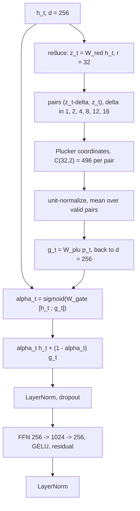
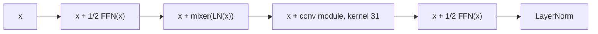

# Architecture

The layer under test is the Causal Grassmann layer of Zhang Chong, "Attention Is Not What You Need"
([arXiv 2512.19428](https://arxiv.org/abs/2512.19428)). It replaces self-attention with a fixed-offset,
pairwise mixer that encodes each pair of token states as a 2D subspace (a point on a Grassmann manifold).
Formulas and proofs are in [math.md](math.md).

## Grassmann block

Code: `GrassmannMixer` (reduce, pairs, Plucker, mean, project) in `python/src/grassmann_speech/mixer.py`,
`GrassmannBlock` (gate, norms, FFN) in `blocks.py`.

| part | shape | parameters |
|---|---|---|
| W_red | 256 -> 32 | 8,224 |
| W_plu | 496 -> 256 | 127,232 |
| W_gate | 512 -> 256 | 131,328 |
| 2 LayerNorms | 256 | 1,024 |
| FFN | 256 -> 1024 -> 256 | 525,568 |
| **Grassmann block** | | **793,376** |
| Transformer block (QKV, output, 2 LayerNorms, FFN) | | 789,760 |

The mixer never compares a token with all others. Each position sees 6 earlier positions, so cost grows
linearly with sequence length.

## Language models (e01)

| model | blocks | embeddings (30,522 x 256 + 128 x 256) | final LN | total | paper |
|---|---|---|---|---|---|
| Transformer, 6 layers | 6 x 789,760 | 7,846,400 | 512 | **12,585,472** | 12.59M |
| Grassmann, 6 layers | 6 x 793,376 | 7,846,400 | 512 | **12,607,168** | 13.00M |
| Grassmann with symmetric products (control) | 6 x 793,376 | 7,846,400 | 512 | 12,607,168 | - |

Transformer block: post-LN, 4 heads, causal scaled dot-product attention, FFN 1024, dropout 0.1.

## Implementation choices

The paper leaves these open. Each choice is fixed in code and tested.

| id | question | paper | this repo |
|---|---|---|---|
| A1 | offset direction | prints the pair (z_t, z_t+delta) and calls the layer causal | pair (z_t-delta, z_t) assigned to t; a unit test checks no future token reaches a logit |
| A2 | offsets per layer | all of {1, 2, 4, 8, 12, 16} per layer, or one per layer | both: all offsets (receptive field 96 tokens) is the default; one offset per layer (43 tokens) is an e01 arm |
| A3 | position with no valid pair | not stated | g_t = 0 |
| A4 | Plucker normalization | "optional" | on, eps 1e-6 |
| A5 | aggregation | mean or sum | mean |
| A6 | ~65.8k parameters per layer not explained by the equations | not stated | omitted; 12,607,168 vs the paper's 13.00M |
| A7 | dropout and init | not stated | dropout 0.1 after the mix LayerNorm, on the FFN branch and on embeddings; PyTorch default init |
| A8 | baseline norm placement | "standard" Transformer | post-LN, same as the Grassmann block |
| A9 | position table | not stated | learned, 128 rows (block length 128) |

## Same-size control

`features="symmetric"` swaps the Plucker minors a_i b_j - a_j b_i for symmetric products a_i b_j + a_j b_i.
Size, offsets, normalization, gate and parameter count stay the same. The symmetric feature is not a
function of the plane span(a, b), so it isolates what the Grassmann geometry adds.

## Mean-first (anchored) form

The paper projects every unit pair vector to d and then averages. All pairs at t share z_t and the Plucker map
is linear in each argument, so the average can move inside: one 496-vector per token from a norm-weighted
partner sum. The output is identical (unit test in float64, 1e-12), and the layer runs 3.5x faster on an
Apple GPU ([results.md](results.md#e00-speed-probe)). Proof in [math.md](math.md#mean-first-form-is-exact).
`mean_first=False` keeps the paper's form.

## Speech: Conformer-CTC with a mixer slot

Used by the e00 speed probe; the shape of the planned speech experiment.

| mixer | per block | 15 blocks + subsampling + head | total |
|---|---|---|---|
| multi-head attention, 4 heads | 263,680 (with its LN) | 1,522,944 per block | 25,967,240 |
| two-sided gated Grassmann | 267,296 (with its LN) | 1,526,560 per block | 26,021,480 |

Shared parts: subsampling 1,838,080; two FFN modules 1,052,160 and conv module 206,592 per block; CTC head
1,285,000.

Two-sided Grassmann (this repo's variant, not the paper's method): speech is not generated left to right, so
each position also pairs with z_t+delta. Both pairs are ordered (earlier, later); Plucker antisymmetry then
tells past from future. The gate runs as a residual branch, `(1 - alpha)(g - u)` with u = LN(x): the paper's
blend alpha u + (1 - alpha) g minus u, so alpha = 1 adds nothing to the residual stream.
