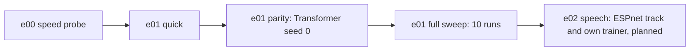

# Experiments

What each run measured, how it was set up, and the command that repeats it. Numbers: [results.md](results.md).



## e00: speed and memory probe

Question: how fast does each arm train on an Apple GPU, and does `ctc_loss` on MPS match CPU?

| section | arms | sizes |
|---|---|---|
| CTC loss parity | MPS vs CPU | T 316, batch 4, vocab 5000, 60 targets |
| blocks | attention (causal SDPA), Grassmann as written, mean-first, two-sided; d 256, r 32, FFN 1024 | length 128 to 4096, 16,384 tokens per step |
| e01 LM step | Transformer and Grassmann, 6 layers | batch 32 x 128, vocab 30,522 |
| Conformer-CTC step | 15 x 256, attention vs two-sided Grassmann; fp32 and bf16 autocast | batch 8 and 16 utterances of 12.7 s, vocab 5000 |

- Inputs: synthetic tensors, seed 0. No download.
- Timing: 3 warm-up steps per arm, then 20 rounds that time every arm once (interleaved), MPS synchronize around
  each step. Median reported.
- FLOPs: `torch.utils.flop_counter` on CPU at batch 1, scaled by batch; matmuls and convolutions only.
- Output: `reports/e00_mps_probe/<UTC time>.json`, written after every section.

```bash
make probe-quick   # code paths, tiny sizes, ~10 s
make probe         # the probe; refuses to start without AC power
```

Run 1 found the Grassmann layer 5x slower than attention at 128 tokens, with time spent in elementwise pair
work. The mean-first (anchored) form ([math.md](math.md#mean-first-form-is-exact)) replaced it; run 2 measured
3.5x faster Grassmann steps with identical outputs.

## e01 quick

Checks the code paths of all 10 e01 runs before any long run: 1 epoch of 5 batches per run, 5 evaluation
batches, output to `work/e01/quick/`. Not a result.

```bash
make e01-quick     # ~25 s on an M3 Pro
```

It confirms the exact parameter counts (12,585,472 and 12,607,168), the token counts of the splits (train
2,303,695, validation 238,656, test 273,178) and that every arm trains and evaluates.

## e01 parity: Transformer, seed 0

Question: does the Transformer baseline reproduce the paper (val PPL 248.4) before any Grassmann number is read?
Pass band: 241.0 to 253.6.

```bash
make e01-parity    # ~0.8 h on an M3 Pro
```

- Attempt 1 failed: embeddings at N(0, 0.02) with gradient clip 1.0 stalled at unigram loss (best val PPL 1388.4).
- Attempt 2 passed at 247.1 with the optimizer, schedule and init of kanenorman's reimplementation
  ([github.com/kanenorman/grassmann](https://github.com/kanenorman/grassmann), 248.7): PyTorch default N(0, 1)
  embeddings, embedding dropout 0.1, no gradient clip.

## e01 full sweep

Question: does this Causal Grassmann layer reproduce the paper's Wikitext-2 result at 13M parameters, and does
the Plucker structure beat a same-size control without it?

| arm | model | seeds |
|---|---|---|
| transformer | 6 layers, d 256, 4 heads, FFN 1024, post-LN | 0, 1, 2 |
| grassmann | 6 layers, r 32, all offsets {1, 2, 4, 8, 12, 16} per layer, unit Plucker, mean, gate, post-LN | 0, 1, 2 |
| control_symmetric | grassmann with a_i b_j + a_j b_i in place of the Plucker minors | 0, 1, 2 |
| grassmann_one_offset | layer l uses offset l of {1, 2, 4, 8, 12, 16} | 0 |

Shared settings (`python/e01_layer_parity.toml`):

| setting | value |
|---|---|
| data | Wikitext-2-raw-v1, `Salesforce/wikitext` @ b08601e04326c79dfdd32d625aee71d232d685c3 |
| tokenizer | bert-base-uncased WordPiece, `google-bert/bert-base-uncased` @ 86b5e0934494bd15c9632b12f734a8a67f723594, no special tokens |
| blocks | 128 tokens, contiguous, non-overlapping |
| training | batch 32, 30 epochs, AdamW lr 1e-3, weight decay 0.01, cosine over epochs, no clip, dropout 0.1 |
| selection | best validation PPL over epochs; test PPL read at that epoch |

```bash
make e01           # 10 runs in config order, ~9 h on an M3 Pro; finished runs are skipped
```

Each run writes `reports/e01_layer_parity/<arm>_s<seed>.json` after every epoch: history, best epoch,
environment and commit. Grassmann arms also log the pair geometry at the end.

Outcome: the Transformer reproduces the paper (247.9 +- 2.3); Grassmann lands 33 percent above it (paper: 11);
the symmetric control ties Grassmann, so the Plucker geometry adds nothing measurable here; one offset per layer
does better than all offsets (one seed).

Limits:
- The paper names no tokenizer, optimizer or schedule; the recipe above is tuned for neither arm.
- One seed for one offset per layer, so its edge is not yet a measured difference.
- The paper reports validation perplexity only; test perplexity here is extra.

## e02: Grassmann vs attention in a Conformer-CTC on LibriSpeech-100 (planned)

Status: code complete and checked on CPU; not run. No e02 number exists yet.

Question: does the two-sided Grassmann mixer replace self-attention in a 15 x 256 Conformer-CTC trained on
LibriSpeech-100 at matched size, and does its Plucker structure beat the same-size symmetric control?

Arms: attention, grassmann, symmetric, no_mixer ([architecture.md](architecture.md#speech-conformer-ctc-e02)). Target for
the attention arm: 9.8 / 23.3 WER on test-clean / test-other, greedy CTC, no LM (Miyazaki et al. 2024,
[arXiv 2406.16808](https://arxiv.org/abs/2406.16808), Table 1; the 15-block encoder is inferred from its 27.0M
parameters).

Two tracks run the same arms:

| | ESPnet track (`e02_espnet/`) | own trainer (`python/e02_ctc.py`) |
|---|---|---|
| role | parity: the recipe behind the published number | an independent second measurement |
| code | ESPnet 202611, recipe `egs2/librispeech_100/asr1` @ v.202611, unpatched; encoders registered at runtime | plain PyTorch with this repo's modules |
| environment | Python 3.13, torch 2.11.0 (`e02_espnet/uv.lock`) | Python 3.15, torch 2.15.0 (`python/uv.lock`) |

Recipe: `conf/tuning/train_asr_ctc_e_branchformer_e12_mlp1024_linear1024.yaml` with the encoder swapped.

| setting | ESPnet track | own trainer |
|---|---|---|
| data | LS-100, speed perturbation 0.9 / 1.0 / 1.1, utterances over 30 s dropped | same; soxr resampling instead of sox |
| validation | dev-clean + dev-other | same |
| features | 80 log-mel, FFT 512, window 400, hop 160, global MVN | same log-mel; MVN from 2,000 training utterances |
| SpecAugment | time warp 5, 2 frequency masks 0 to 27, 5 time masks 0 to 5 percent | same |
| tokens | SentencePiece unigram 5000 | unigram 5000 (Hugging Face tokenizers), blank id 0 |
| optimizer | Adam 2e-3, weight decay 1e-6, WarmupLR 15k steps, gradient clip 5 | same |
| batch | numel batching, 16M bins, gradient accumulation 4 | same rule |
| precision | fp16 AMP | bf16 autocast on CUDA |
| epochs, selection | 70; average of the 10 best by validation CER | 70; average of the 10 best by validation WER |
| decoding | CTC, beam 1 | greedy best path |
| scoring | `python -m grassmann_speech.wer`: WER and CER with error counts, paired bootstrap over speakers | same |

```bash
make e02-data                          # OpenSLR SLR12 into data/librispeech, 7.6 GB
make e02-espnet-setup                  # sparse ESPnet checkout in vendor/espnet, e02_espnet/.venv; needs sox and flac
make e02-espnet-prepare                # recipe stages 1 to 10, once
make e02-espnet ARM=attention SEED=0   # parity run first, then grassmann, symmetric, no_mixer
make e02-prepare                       # own trainer: lists, sealed dev/test manifests, tokenizer, MVN
make e02-train ARM=attention SEED=0 && make e02-decode ARM=attention SEED=0
uv run --project python python -m grassmann_speech.wer REF HYP_A --against HYP_B   # paired bootstrap
```

Outputs: `reports/e02_espnet/<arm>_s<seed>/` and `reports/e02_own/<arm>_s<seed>.json` with per-epoch history,
hypotheses, WER and CER per set, environment and commit.

Checks done on CPU (Apple M3 Pro, 2026-11-14):
- `make test`: 63 unit checks, including the parameter formulas, padding invariance for every arm, the fp32 mix under
  bf16 autocast, the mel scale, batching, scorer and bootstrap.
- `make e02-quick`: all four arms through prepare, train, checkpoint averaging, decode and scoring on a synthetic corpus,
  9 s. A 60-epoch run on that corpus took the training loss from 87 to 6 and held-out WER from 100 to 78 (attention)
  and 81 (Grassmann).
- `make e02-espnet-check`: in ESPnet the four arms have exactly the sizes above; this repo's log-mel is within 4.8e-7
  of ESPnet's frontend; every arm trains one epoch and decodes through ESPnet's own entry points, 135 s.

Expected cost: about 4 to 8 h per run on one A100 (derived from published step rates, not measured); the recipe needs a
40 GB or larger GPU at 16M bins. Seed 0 of both tracks is 8 runs.

Limits:
- The 9.8 / 23.3 target belongs to an inferred encoder size.
- The own trainer departs from ESPnet where the table says; its numbers stand on their own.
- Two-sided Grassmann is this repo's variant; the paper's layer is causal.
